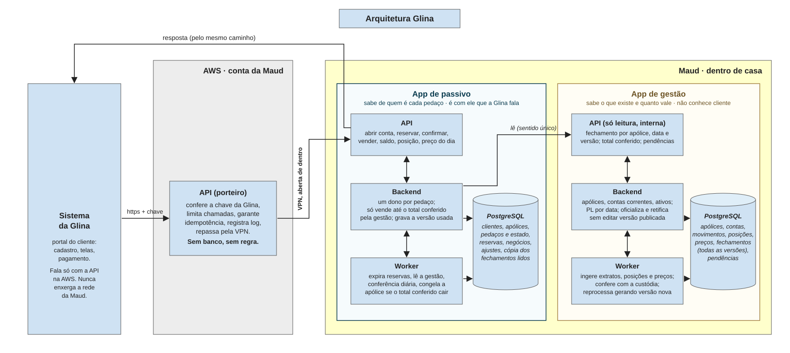

# maud-glina-liability

O **app de passivo** da arquitetura Glina: **sabe de quem é cada pedaço**. É com ele que a Glina fala, passando pelo porteiro.



| Peça do desenho | Repositório | Onde roda |
|---|---|---|
| API (porteiro) | `maud-glina-api` | AWS, conta da Maud |
| **App de passivo** | `maud-glina-liability` (este) | Maud, dentro de casa |
| App de gestão | `maud-glina-management` | Maud, dentro de casa |

## As peças deste app

Um código, dois processos, um banco:

| Peça | O que faz | Comando |
|---|---|---|
| **API** | abrir conta, reservar, confirmar, vender, saldo, posição, preço do dia | `manage.py runserver` (dev) / gunicorn |
| **Backend** | um dono por pedaço; só vende até o total conferido pela gestão; grava a versão usada | os módulos em `src/maud/modules/` |
| **Worker** | expira reservas, lê a gestão, conferência diária, congela a apólice se o total conferido cair | `manage.py worker` |
| **PostgreSQL** | clientes, apólices, pedaços e estado, reservas, negócios, ajustes, cópia dos fechamentos lidos | `docker compose up -d db` |

### Como não vende o que não existe

1. A gestão confere a posição de cada apólice com a custódia e publica o total conferido. Só o que bateu conta.
2. O passivo só reserva ou vende enquanto **vendidos + reservados ≤ total conferido**.
3. Conferência diária: soma dos pedaços = total conferido, e versão em uso = versão vigente. Se o total cai, a apólice congela e vira item de conferência. Nada se corrige sozinho.

### Fronteiras

- Banco separado do app de gestão, nenhuma tabela em comum.
- Só o passivo chama a gestão, e só para ler. A gestão não sabe que o passivo existe.
- Nenhum banco tem rota de fora. A VPN libera só o backend do passivo.

## Situação

Estrutura inicial, criada a partir do `maud-boilerplate`. **Ainda não há módulo de negócio**: só o módulo de demonstração `example`, que sai quando o primeiro módulo real tiver uma slice de comando e uma de consulta (skill `new-module`, seção "Remover o example").

Próximos passos, pelo padrão: definir os termos em `docs/glossary.md`, criar o primeiro módulo com a skill `new-module` e as primeiras slices com `new-feature`.

## Subir local

Pré-requisitos: Python 3.12, [uv](https://docs.astral.sh/uv/) e Docker.

```
cp .env.example .env
docker compose up -d db                  # Postgres na porta 5434
uv sync
uv run python manage.py makemigrations   # gera as migrations só na sua máquina (não vão para o git)
uv run python manage.py migrate
git config core.hooksPath .githooks      # uma vez por clone: liga a checagem antes do push
uv run python manage.py runserver 8001   # API em http://localhost:8001/api/v1/docs
uv run python manage.py worker           # Worker (outro terminal)
```

Tudo em containers: `docker compose up --build` (API na porta 8001).

**Build e migrations.** Migration não vai para o git, mas vai na imagem: o build copia as que estão na pasta do projeto e falha se algum model mudou sem migration gerada. Antes do build, gere na sua máquina (`uv run python manage.py makemigrations`). O serviço `migrate` aplica as migrations antes da API e do Worker subirem; o `collectstatic` roda no build. **No servidor, faça o build sempre na mesma pasta** (`git pull` nela): um clone novo não tem as migrations que o banco de lá já aplicou.

Cada repositório da arquitetura usa portas próprias, para os três rodarem lado a lado: porteiro 8000; passivo 8001 e Postgres 5434; gestão 8002 e Postgres 5435.

No Linux/macOS, se o hook não rodar: `chmod +x .githooks/pre-push`.

## Verificações

```
uv run python scripts/check.py
```

Roda as mesmas verificações do pre-push: nenhuma migration no git, agentes de IA sincronizados, formatação, lint, tipos, fronteiras entre módulos e testes (em Postgres real, nunca SQLite).

## Como trabalhamos

Resumo do [ADR 0005](docs/adr/0005-lightweight-process.md):

- Direto na `main`, commits pequenos, `git pull --rebase` antes de começar e antes de subir.
- Antes de cada push, o hook roda todas as verificações. Se algo falhar, o push não sobe.
- Terminar uma tarefa inclui documentar: entrada nova em [`docs/journal.md`](docs/journal.md) e lista de slices do módulo atualizada.
- **Nomes em inglês, textos em português** ([ADR 0003](docs/adr/0003-language.md)).

## Agentes de IA

Funciona com **Claude Code** e **Codex**. Instruções, skills e hooks têm uma fonte só: `AGENTS.md` e `.agents/`. O que é do Claude (`CLAUDE.md`, `.claude/skills/`) é gerado:

```
uv run python scripts/sync_agents.py
```

Skills: `/new-module`, `/new-feature`, `/new-migration` no Claude; `$new-module`... no Codex. **Codex, uma vez por pessoa:** abra o Codex na raiz do repositório e aprove o hook do projeto em `/hooks`.

## Onde ler

- `AGENTS.md`: mapa do código e regras (vale para humanos e para qualquer agente de IA)
- `docs/context.md`: o papel deste app na arquitetura Glina
- `docs/architecture.md`: por que a estrutura do código é assim
- `docs/adr/`: decisões registradas (a deste app é a 0008)
- `docs/glossary.md`: termos do negócio
- `docs/contracts/`: regras da API, eventos e um arquivo por parceiro
- `docs/journal.md`: o que foi entregue, por quê e o que ficou pendente
